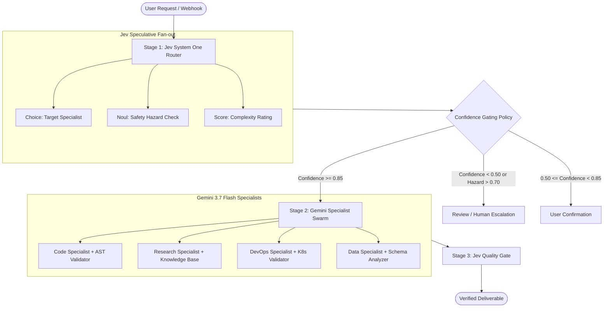

# TypeSafe Jev & Gemini Multi-Agent Framework (`Jev_Learning`)

[](https://www.python.org/downloads/)
[](https://fastapi.tiangolo.com)
[](https://opensource.org/licenses/MIT)
[](https://swagger.io/)

A production-ready reference architecture and comprehensive **10-Chapter Master Course (Zero to Hero)** demonstrating how to use **TypeSafe Jev** as a high-speed **System One Decision Router** alongside **Google Gemini 3.7 Flash** specialist agents.

---

## 🌟 Key Highlights

- ⚡ **System One Decision Routing**: Evaluates intent, safety, and complexity in 70–500 ms using TypeSafe Jev (`openrouter/typesafe/jev-router` / `typesafe/jev-1.13.0`).
- 🤖 **Specialist Agent Swarm**: Powered by Google Gemini 3.7 Flash (`l-s-Poc/gemini-3.7-flash`) with dynamic reasoning tokens and ReAct tool calling.
- 🎯 **3-Tier Confidence Gating**: Mathematical policy routing (`AUTO >= 0.85`, `CONFIRM 0.50–0.84`, `REVIEW < 0.50`) preventing costly misroutes and safety risks.
- 🛠️ **Google ADK & OpenAPI Compatible**: Fully compliant function schemas with interactive Swagger docs at `/docs`.
- 📚 **10-Chapter "Zero-to-Hero" Course**: Exhaustive guides covering cognitive duality, probability calibration (RLCD), speculative fan-out, and enterprise DevOps patterns.

---

## 🏛️ System Architecture



---

## 📂 Project Structure

```
Jev_Learning/
├── .env.example                      # Template environment configuration
├── .gitignore                        # Git ignore rules (secrets, venv, cache)
├── requirements.txt                  # Python dependencies
├── README.md                         # Project documentation
│
├── app/                              # Core Application Package
│   ├── config.py                     # Central Pydantic settings
│   ├── jev_client.py                 # TypeSafe Jev Client (Noul, Choice, Score)
│   ├── agent_framework.py            # Google ADK & OpenAPI Agent Base & Tools
│   ├── orchestrator.py               # Two-Stage SDE Multi-Agent Orchestrator
│   ├── main.py                       # Interactive Rich CLI Terminal UI
│   ├── api.py                        # FastAPI REST Service with Swagger UI
│   └── specialists/                  # Swarm of Specialist Agents
│       ├── code_agent.py             # AST syntax validation & execution
│       ├── research_agent.py         # Knowledge retrieval & synthesis
│       ├── devops_agent.py           # Kubernetes & CI log triage
│       └── data_agent.py             # SQL & JSON Schema analysis
│
├── examples/                         # Standalone Runnable Demonstrations
│   ├── 01_jev_primitives.py          # Noul, Choice, and Score primitives
│   ├── 02_confidence_gating.py       # Confidence policy tiers & human-in-the-loop
│   ├── 03_speculative_fanout.py      # Multi-question single-pass batching
│   └── 04_multi_agent_pipeline.py    # Full multi-agent orchestration
│
└── course/                           # 10-Chapter Master Course (Zero to Hero)
    ├── 00_course_overview.md         # Syllabus & Curriculum Map
    ├── 01_introduction_to_system_one_and_jev.md
    ├── 02_core_primitives_noul_choice_score.md
    ├── 03_structuring_state_and_questions.md
    ├── 04_calibrated_confidence_and_probability.md
    ├── 05_architectural_patterns_for_agents.md
    ├── 06_multi_agent_orchestration_with_jev_and_gemini.md
    ├── 07_google_adk_and_openapi_integration.md
    ├── 08_guardrails_evaluation_and_quality_scoring.md
    ├── 09_production_deployment_monitoring_and_optimization.md
    └── 10_expert_case_studies_and_capstone.md
```

---

## 🚀 Getting Started

### 1. Prerequisites

- Python 3.10, 3.11, 3.12, 3.13, or 3.14
- Access to an OpenAI-compatible Gateway / OmniRouter / OpenRouter endpoint

### 2. Clone & Setup Virtual Environment

```bash
git clone https://github.com/your-username/Jev_Learning.git
cd Jev_Learning

# Create virtual environment
python -m venv .venv

# Activate virtual environment
# On Linux/macOS:
source .venv/bin/activate
# On Windows (PowerShell):
.\.venv\Scripts\Activate.ps1
# On Windows (CMD):
.\.venv\Scripts\activate.bat

# Install dependencies
pip install -r requirements.txt
```

### 3. Configure Environment Variables

Copy `.env.example` to `.env` and fill in your API credentials:

```bash
cp .env.example .env
```

Edit `.env`:
```env
OMNIROUTER_BASE_URL=http://localhost:20128/v1
OMNIROUTER_API_KEY=your_api_key_here

JEV_MODEL=openrouter/typesafe/jev-router
JEV_NATIVE_MODEL=typesafe/jev-1.13.0
SPECIALIST_MODEL=l-s-Poc/gemini-3.7-flash

CONFIDENCE_THRESHOLD_AUTO=0.85
CONFIDENCE_THRESHOLD_REVIEW=0.50
```

---

## 💻 Running the Application

### Option A: Interactive CLI Terminal UI

Launch the interactive terminal application with telemetry and probability charts:

```bash
python app/main.py
```

### Option B: Standalone Examples

Run individual demonstrations covering core concepts:

```bash
# 1. Test Noul, Choice, and Score primitives
python examples/01_jev_primitives.py

# 2. Test Confidence Gating and Human-in-the-Loop policy
python examples/02_confidence_gating.py

# 3. Test Speculative Fan-out (5 questions in 1 call)
python examples/03_speculative_fanout.py

# 4. Test Full Multi-Agent SDE Pipeline
python examples/04_multi_agent_pipeline.py
```

### Option C: FastAPI REST Server & OpenAPI Docs

Start the production REST service:

```bash
python app/api.py
```

- **Health Check**: `GET http://localhost:8000/v1/health`
- **Interactive Swagger UI**: `http://localhost:8000/docs`
- **ReDoc Documentation**: `http://localhost:8000/redoc`

---

## 📖 Complete Master Course (Zero to Hero)

| Chapter | Topic | Description |
| :--- | :--- | :--- |
| [**Overview**](course/00_course_overview.md) | Course Map | Complete curriculum and learning path |
| [**Chapter 1**](course/01_introduction_to_system_one_and_jev.md) | System One & Jev | Cognitive duality, why LLMs fail at routing, TypeSafe background |
| [**Chapter 2**](course/02_core_primitives_noul_choice_score.md) | Core Primitives | Deep dive into Noul (yes/no), Choice (1-of-N), and Score (ordinal) |
| [**Chapter 3**](course/03_structuring_state_and_questions.md) | Context & State | Structuring JSON state, backtick field referencing, instructions |
| [**Chapter 4**](course/04_calibrated_confidence_and_probability.md) | Probability Calibration | RLCD training, mathematical confidence vs probability, entropy |
| [**Chapter 5**](course/05_architectural_patterns_for_agents.md) | Agentic Patterns | Speculative fan-out, cascades, intent dispatch, composite scoring |
| [**Chapter 6**](course/06_multi_agent_orchestration_with_jev_and_gemini.md) | Hybrid Swarms | Wiring Jev router with Gemini 3.7 Flash specialists |
| [**Chapter 7**](course/07_google_adk_and_openapi_integration.md) | OpenAPI & ADK | Tool decorators, schema validation, ReAct loops |
| [**Chapter 8**](course/08_guardrails_evaluation_and_quality_scoring.md) | Guardrails & Triage | Pre-flight safety, post-flight evaluation, CI failure triage |
| [**Chapter 9**](course/09_production_deployment_monitoring_and_optimization.md) | Production & Costs | Latency profiling, token economics ($0.042/M tokens vs $5/M) |
| [**Chapter 10**](course/10_expert_case_studies_and_capstone.md) | Case Studies | Kubernetes Alertmanager, CI/CD flaky test rerunner, Capstone |

---

## 📜 License

This project is licensed under the MIT License — see the [LICENSE](LICENSE) file for details.
